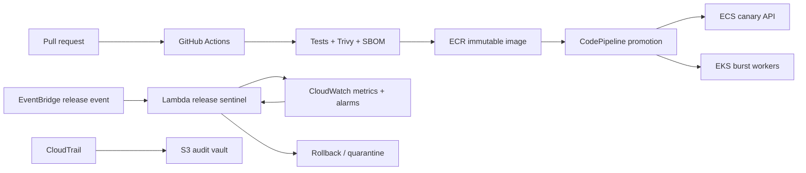

# Nebula Forge

## The AI Release Control Plane

Nebula Forge is a production-style release platform for AI services. It treats every model or prompt release as an auditable, reversible deployment event: build an immutable image, run policy gates, promote through environments, and automatically quarantine unhealthy versions.

This is a standalone portfolio project — separate from any other application.



## Why it is “crazy”

- Canary releases are evaluated by a Lambda sentinel that reads CloudWatch error-rate and latency signals.
- The same release artifact can be promoted to ECS Fargate or EKS workers.
- Terraform owns the long-lived AWS foundation; CloudFormation owns the event-driven release control plane.
- CodePipeline is an AWS-native promotion lane; GitHub Actions is the developer feedback lane.
- CloudTrail and an immutable audit bucket record who changed what and when.
- OIDC, immutable tags, non-root containers, SBOMs, image scanning, health checks, and least privilege are first-class.

## Stack coverage

`Terraform` · `CloudFormation` · `AWS SAM` · `ECS Fargate` · `EKS` · `Lambda` · `CloudWatch` · `CloudTrail` · `GitHub Actions` · `CodePipeline` · `CodeBuild` · `ECR` · `EventBridge` · `SQS` · `IAM OIDC` · `Docker` · `Kubernetes`

## Layout

```text
terraform/       VPC, ECR, ECS canary service, CloudWatch, CloudTrail
cloudformation/  release sentinel Lambda, EventBridge, SQS DLQ, alarms
kubernetes/      EKS worker deployment, HPA, PDB, network policy
services/        Node.js release API and sentinel package
pipelines/       CodePipeline and CodeBuild definitions
.github/         CI, security, release, and Terraform workflows
```

## Run locally

```bash
cd services/release-api
npm ci
npm test
docker build -t nebula-forge-api .
docker run --rm -p 8080:8080 nebula-forge-api
curl http://localhost:8080/health
```

## Deploy

```bash
terraform -chdir=terraform init
terraform -chdir=terraform plan -var='environment=dev'
sam build --template-file cloudformation/template.yaml
sam deploy --guided
```

Production accounts should use an S3/DynamoDB Terraform backend, GitHub OIDC restricted to this repository, private subnets with VPC endpoints, a customer-managed KMS key, WAF, and separate AWS accounts per environment.

## Resume line

Built Nebula Forge, a production-style AWS AI release control plane using Terraform, CloudFormation/SAM, ECS Fargate, EKS, Lambda, CloudWatch, CloudTrail, GitHub Actions, CodePipeline, CodeBuild, ECR, EventBridge, IAM OIDC, container scanning, SBOMs, canary releases, and automated rollback signals.
